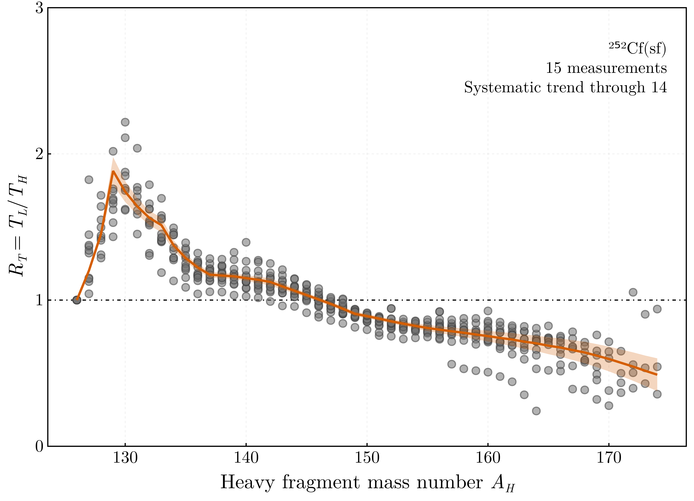
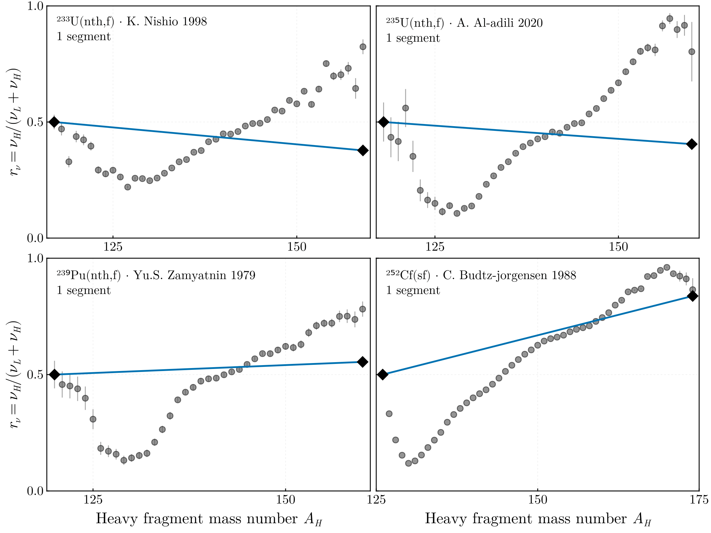

# FissionTemperatureRatio.jl

[](https://github.com/PaulGoG/FissionTemperatureRatio.jl/actions/workflows/CI.yml)
[](https://codecov.io/gh/PaulGoG/FissionTemperatureRatio.jl)
[](https://PaulGoG.github.io/FissionTemperatureRatio.jl/stable/)
[](https://julialang.org)
[](https://github.com/JuliaTesting/Aqua.jl)
[](https://github.com/aviatesk/JET.jl)
[](https://github.com/domluna/JuliaFormatter.jl)
[](LICENSE)

Extraction of the temperature ratio `R_T = T_L/T_H` of complementary fully accelerated fission
fragments from experimental prompt neutron multiplicity data, described by joined straight
segments. The fragmentation domain, the level density parameters and the relation between `R_T`
and the excitation-energy partition are taken from
[FissionFragmentsDomain.jl](https://github.com/PaulGoG/FissionFragmentsDomain.jl), which the
prompt emission codes that read `R_T(A_H)` also use.

The method, its conventions and its equation numbering are those of *Eur. Phys. J. A* **60**, 190
(2024), [doi:10.1140/epja/s10050-024-01375-7](https://doi.org/10.1140/epja/s10050-024-01375-7).
The [documentation](https://PaulGoG.github.io/FissionTemperatureRatio.jl/stable/) covers the
[method](docs/src/method.md), its [validation](docs/src/validation.md) against the paper, the
[configuration](docs/src/configuration.md) keys, the [output contract](docs/src/consuming.md) for
consuming codes and the [naming](docs/src/naming.md) of files and columns.

```
FissionTemperatureRatio/
├── config/          pipeline configurations, one TOML file per fissioning system
├── data/            input data, held locally, README.md on sources and terms; sims/ for run output
├── scripts/run.jl   pipeline entry point, own environment with the plotting stack
├── src/             configuration, inversion, segmented fit and curve, pipeline, provenance
├── ext/             CairoMakie extension: figures
├── test/            test suite, own environment
├── bench/           benchmarks, own environment
├── docs/            Documenter site, own environment, references.bib; assets.jl renders figures
├── formatter/       JuliaFormatter environment used by check.jl
├── check.jl         format, then test
├── activate.jl      activate and instantiate the root environment
├── CITATION.cff     citation metadata for the package and the method paper
└── Project.toml     dependencies and compatibility bounds
```

The full tree is at the [end of this file](#full-file-tree). Generated output is written to
`data/sims/` and `plots/`, neither of which is version-controlled.

## Method

For each fragment pair the prompt neutron multiplicity ratio is identified with the excitation
energy ratio, and the fragment level densities are taken in the Fermi-gas regime. One
fragmentation with `ρ = a_L/a_H` then gives the heavy fragment `E*_H/TXE = 1/(1 + ρ R_T²)`. The
measured `r_ν = ν_H/(ν_L + ν_H)` is resolved by mass alone, and `R_T(A_H)` is the root of

```
r_ν(A_H) = Σ_Z p(Z, A_H) ⟨TXE⟩_Z / (1 + ρ_Z R_T²)  /  Σ_Z p(Z, A_H) ⟨TXE⟩_Z,
```

with `⟨TXE⟩_Z = Q(A_H, Z) + E*_CN − ⟨TKE⟩(A_H)`. The extraction involves no fit and no prompt
emission calculation. With one effective ratio `R_a` in place of `ρ_Z` it reduces to the closed
form `R_T = [(1 - r_ν)/(R_a r_ν)]^(1/2)` of the published method. `r_ν` is described by a
continuous piecewise-linear function whose segment count and breakpoints are selected by the
Bayesian information criterion, and `R_T` follows by the inversion;
[the method](docs/src/method.md) sets this out in full.

## Environments

The package is not registered: clone the repository and work from its root. Each environment
carries an activation script that activates and instantiates it silently. The first
instantiation resolves and precompiles, and is slow.

```
julia activate.jl
julia scripts/activate.jl
julia test/activate.jl
julia docs/activate.jl
julia bench/activate.jl
```

Every runnable script activates its own environment as its first statement, so every command
below runs as written, with no project flag. An interactive session on the package starts with
`julia -i activate.jl`. The formatting environment under `formatter/` is instantiated by
`check.jl` and by CI, not by hand.

Each auxiliary environment takes the package from the local source through a relative
`[sources]` entry (Pkg 1.11, the declared floor). FissionFragmentsDomain.jl is not registered
either; every environment takes it from its repository at a tagged release, which is also the
`[compat]` floor. The activation scripts set `JULIA_PKG_USE_CLI_GIT`, so the fetch goes through
the git executable and the user's git configuration. They resolve before instantiating, so that a
change of dependencies does not leave a manifest stale.

Resolved manifests are not version-controlled: a manifest resolved against one Julia version
would break instantiation on the others the package supports. `scripts/run.jl` copies the resolved
manifest of its environment into the run directory as `Manifest.toml`, so a result stays
attributable to the exact dependency versions that produced it.

## Entry points

Run the pipeline for one fissioning nucleus:

```
julia scripts/run.jl config/U233_nth.toml
```

The tables, the manifest and the provenance record go to `data/sims/<system>/<run identifier>/`
and the figures to `plots/<system>/<run identifier>/`. An existing run of the same identifier is
moved aside as `<run identifier>#1`; [Naming](docs/src/naming.md) lists every file a run writes.

Run the test suite:

```
julia -e 'include("activate.jl"); using Pkg; Pkg.test()'
```

Format the sources in place, then run the tests:

```
julia check.jl
```

`julia check.jl --check` fails on formatting differences instead of rewriting, which is what CI
runs.

Run the benchmarks:

```
julia bench/benchmarks.jl
```

Build the documentation:

```
julia docs/make.jl
```

Regenerate the figures shown below, from the configuration and the input data:

```
julia docs/assets.jl
```

## Status

| Component | State |
|---|---|
| Mass table, shell corrections, charge distribution, fragmentation domain, level density parameters | FissionFragmentsDomain.jl, at the release the environments pin |
| Multiplicity ratio | complete |
| Temperature ratio: charge-resolved inversion, excitation-weighted by `⟨TKE⟩(A)` | complete; a `⟨TKE⟩(A)` dataset is configured for each of the four systems |
| Temperature ratio: ratio of means, mean of ratios | complete |
| Retrieval records and reaction-code qualifiers | complete |
| Segmented description with order selection | complete |
| Pipeline, tabulated output, figures, provenance | complete |
| Per-dataset and systematic-trend curves | complete |
| Averaging over a fragment mass yield distribution | complete |
| Reproduction of published total averages | complete for ²³³U, ²⁵²Cf and ²³⁵U, and for ²³⁹Pu over an inferred Y(A); see [Validation](docs/src/validation.md) |
| Run record with the fragmentation domain, for the consuming code | complete |

CI runs without the input data, which is not redistributable; the published-value and consumer
tests are skipped there and run locally, so the coverage badge reports the data-free part of the
suite.

Versions follow semantic versioning with the pre-1.0 convention. A breaking change, whether to a
configuration key, an output file name or a key of the manifest, raises the minor version; a
patch release carries none. The [changelog](CHANGELOG.md) marks every breaking change.

## Results at a glance

With the published settings the package reproduces the total average temperature ratios of
Table 1 of the paper to within 1.0 % for ²³³U(nth,f), ²⁵²Cf(sf), ²³⁵U(nth,f) and ²³⁹Pu(nth,f);
the exception is Apalin's ²³³U measurement, at 1.9 %. With the shipped settings, which invert
charge by charge on Wahl's charge model, the agreement is within 1.4 %, and 2.1 % for Apalin. The
table's caption names no yield distribution for ²³⁹Pu, so the one used there is inferred by
agreement. The paper did not use this package: its joined segments were drawn by hand through the
multiplicity ratio of each dataset. Here the number of segments and their breakpoints are
selected by a criterion, and the trend combining several datasets is this package's own
construction; the agreement is therefore at the per-cent level.
[Validation](docs/src/validation.md) lists what has and has not been checked.



The temperature ratio of ²⁵²Cf(sf), with every measurement held in grey and the systematic trend
through the fourteen pooled measurements with its uncertainty. Above the symmetric split the light
fragment is the hotter of the pair, and the ratio crosses unity near the most probable
fragmentation.



One measurement from each of the four configured systems, fitted with an increasing number of
joined segments. Points carry the uncertainty propagated from the multiplicity data where the
archive quotes one. For each order the breakpoints are searched exhaustively over the abscissae
the data occupies, and the order is chosen by the Bayesian information criterion, which penalises
every added segment and breakpoint. The selected orders are five, six, four and five.

The systematic trend of each shipped configuration gives the following `⟨R_T⟩` over the primary
yield distribution, with the uncertainty propagated from the fit covariance and the jackknife over
the refits with each pooled dataset or experiment left out:

| System | `R_T` ± `R_T_uncertainty` | `R_T_uncertainty_leave_one_out` |
|---|---|---|
| ²⁵²Cf(sf) | 1.0861 ± 0.0150 | 0.0103 |
| ²³⁵U(nth,f) | 1.1210 ± 0.0152 | 0.0223 |
| ²³⁹Pu(nth,f) | 1.0340 ± 0.0253 | 0.0274 |
| ²³³U(nth,f) | 1.0657 ± 0.0917 | 0.1408 |

The inputs are the retrieval of ExforFissionData.jl v0.7.0; [`data/README.md`](data/README.md)
records their provenance.

## Figures

The plotting stack is a weak dependency, so `using FissionTemperatureRatio` loads in about a
second and pulls in no graphics. Figures come from an extension that loads with CairoMakie:

```julia
using FissionTemperatureRatio, CairoMakie
```

`scripts/run.jl` runs in the environment under `scripts/`, which carries CairoMakie, so a
pipeline run always writes its figures. A caller using the package as a library gets the tables,
the manifest and `run_metadata` without it, and figures through `write_figures` with it.

## Input data

[`data/README.md`](data/README.md) describes the layout, one directory per system and one
subdirectory per measured quantity, and the sources and terms of every file. Each measurement is
one file with one header line, and readers take columns by position, not by header text. The
measurements come from [ExforFissionData.jl](https://github.com/PaulGoG/ExforFissionData.jl), the
supported source of `ν(A)`, `Y(A)` and `⟨TKE⟩(A)`. It writes exactly this layout, with the EXFOR
DatasetID in every file name and a `retrieval.toml` run record naming every dataset the query kept
or excluded. Run its retrieval from its own checkout, with the root of this repository as the
second argument, the output root:

```
julia scripts/retrieve.jl config/U233_nth_nu_vs_A.toml /path/to/FissionTemperatureRatio
```

Without the data the pipeline cannot run, and the tests that need measurements are reported as
skipped in the test summary. The rest of the suite — the inversion on the shipped fragmentation
domains, the configuration, a synthetic run and its run record — runs regardless, on the mass
table and shell corrections FissionFragmentsDomain.jl ships.

## Configuration

Every run is driven by a TOML file under `config/`, which fixes the fissioning nucleus, the
fragmentation range, the level density model, the datasets and their exclusions, the yield
distributions, the segment search and the precision of the tabulated output. The parser enforces
the types, enumerated choices and bounds its comments document, refuses unknown sections and
keys, and fails naming the offending key, so a run cannot start from a configuration it cannot
honour. Every key, with its type, bounds, default and run-identifier token, is listed under
[Configuration](docs/src/configuration.md).

The two sections that fix the physics, `[fragmentation]` and `[level_density]`, and the primary
`⟨TKE⟩(A)` and `Y(A)` datasets of each shipped system are described under
[Configuration](docs/src/configuration.md) and [the method](docs/src/method.md).

To add a fissioning system, place its `ν(A)` datasets in `data/<system>/nu_vs_A/` and copy a
configuration to `config/<system>.toml`.

## Several measurements of one system

Each dataset that reaches the coverage floor gives its own curve, and one further curve, the
systematic trend, is fitted to the combination of the pooled datasets. The curves are
alternatives: a consuming code takes one of them. [The method](docs/src/method.md) describes the
combination and the uncertainty of the trend, and [`data/README.md`](data/README.md) the datasets
the shipped configurations exclude and why.

## Consuming the output

The manifest is the entry point for a code that takes these curves as input, and it is meant to
be read rather than parsed out of file names.

[Consuming the output](docs/src/consuming.md) gives an abridged manifest and the contract in
full; `test/test_manifest.jl` is a consumer that checks it.

## How to cite

FissionTemperatureRatio.jl is written by Paul-Adrian Gogîță. For the method, cite
*Eur. Phys. J. A* **60**, 190 (2024),
[https://doi.org/10.1140/epja/s10050-024-01375-7](https://doi.org/10.1140/epja/s10050-024-01375-7);
for the implementation, cite this repository by its URL,
<https://github.com/PaulGoG/FissionTemperatureRatio.jl>. `CITATION.cff` at the root carries both
in machine-readable form, with the paper as the preferred citation. As BibTeX:

```bibtex
@software{FissionTemperatureRatio,
  author  = {Gogîță, Paul-Adrian},
  title   = {FissionTemperatureRatio.jl},
  version = {0.5.0},
  year    = {2026},
  url     = {https://github.com/PaulGoG/FissionTemperatureRatio.jl}
}
```

## Licensing

The source code is under the MIT licence in `LICENSE`.

That licence does not extend to the contents of `data/`, none of which originates with this
package. The atomic mass evaluation, the charge distribution systematics, the shell corrections
and every prompt neutron multiplicity and fragment mass yield measurement are third-party
scientific data, held locally and not redistributed here. `data/` carries only its own README,
which records what each input is, where it came from and how it should be cited. Any result
derived from a measurement should cite that measurement.

## Full file tree

<details>
<summary>Every tracked directory and entry file</summary>

```
FissionTemperatureRatio/
├── .github/                        continuous integration and dependency updates
│   ├── dependabot.yml
│   └── workflows/                  CI.yml (tests, coverage, docs) and format.yml (formatting gate)
├── .JuliaFormatter.toml            formatting rules, enforced by check.jl and CI
├── .gitignore                      ignores run output, resolved manifests and the docs build
├── activate.jl                     activate and instantiate the root environment
├── CHANGELOG.md                    notable changes
├── CITATION.cff                    citation metadata for the package and the method paper
├── check.jl                        pre-commit: format, then test
├── LICENSE                         MIT, covering the source code only
├── Project.toml                    dependencies and compatibility bounds
├── bench/                          benchmark suite, own environment
│   ├── activate.jl
│   ├── benchmarks.jl
│   └── Project.toml
├── config/                         pipeline configurations, one per fissioning system
│   ├── Cf252_sf.toml
│   ├── Pu239_nth.toml
│   ├── U233_nth.toml
│   └── U235_nth.toml
├── data/                           input data, held locally and not version-controlled
│   ├── README.md                   what each input file is, where it comes from, its terms
│   └── sims/                       run output, data/sims/<system>/<run identifier>/ (untracked)
├── docs/                           Documenter site, own environment
│   ├── activate.jl
│   ├── assets.jl                   regenerates the figures the README and the documentation show
│   ├── make.jl
│   ├── Project.toml
│   └── src/                        index, method, validation, configuration, consuming, naming, reference, references; assets/ for figures
│       └── references.bib          DOI-keyed bibliography of the method and validation pages
├── ext/                            weak-dependency extensions
│   └── FissionTemperatureRatioCairoMakieExt.jl   publication figures, loaded with CairoMakie
├── formatter/                      JuliaFormatter environment, version-bounded
│   ├── activate.jl
│   └── Project.toml
├── scripts/                        pipeline entry point, own environment
│   ├── activate.jl
│   ├── Project.toml
│   └── run.jl                      pipeline entry point
├── src/
│   ├── autocorrelation.jl          errors of pooled datasets along the mass axis: correlogram, decay
│   ├── configuration.jl            TOML configuration, parsed and validated; model builders
│   ├── consensus.jl                combining datasets, and the diagnostics describing them
│   ├── extracted_curve.jl          one extracted curve: fit, R_T, covariance; its averages
│   ├── FissionTemperatureRatio.jl  module definition and public interface
│   ├── kinetic_energy.jl           ⟨TKE⟩(A) onto the heavy-mass range
│   ├── multiplicity_ratio.jl       ν(A) input and the multiplicity ratio
│   ├── pipeline.jl                 the run, from input to tabulated output and run record
│   ├── plotting.jl                 figure interface; the implementation is in ext/
│   ├── provenance.jl               run identification and metadata
│   ├── retrieval.jl                the retrieval records beside the inputs, read once and checked
│   ├── segmented_fit.jl            continuous piecewise-linear regression
│   ├── temperature_ratio.jl        the inversion over a tabulated r_ν
│   └── yields.jl                   Y(A) directories and the independent-points total average
└── test/                           test suite, own environment
    ├── activate.jl
    ├── Project.toml
    ├── runtests.jl
    ├── fixtures.jl                 locates the staged input data; the tests that need it are skipped without it
    ├── test_<module>.jl            one file per source module with unit tests
    ├── test_experiments.jl         datasets of one experiment pooled as one
    ├── test_manifest.jl            a consumer: reads a run through FissionFragmentsDomain.jl alone
    ├── test_published_values.jl    the total averages against Tables 1 and 2 of the paper
    └── test_quality.jl             Aqua, JET, ExplicitImports
```

</details>
