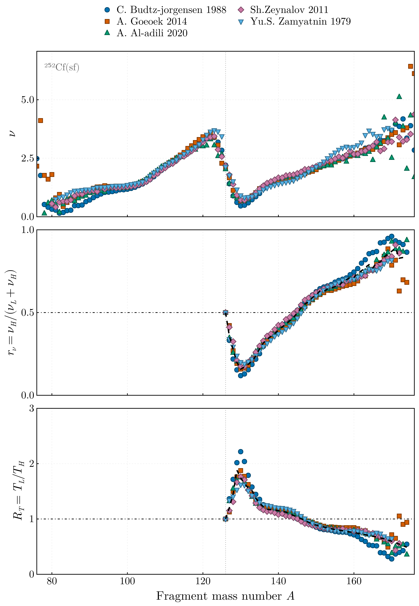
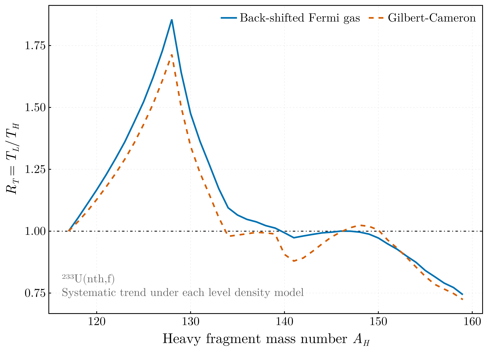

# Method

## Temperature ratio from multiplicity data

The method and its conventions are those of [Tudora2024](@cite). Two premises carry the
extraction. The prompt neutron multiplicity ratio of complementary fragments follows their
excitation energy ratio, eq. (1) of that paper, and the fragments are excited highly enough for
their level densities to be of Fermi-gas form, ``E^* = a T^2``. For one fragmentation
``(A_H, Z)`` with ``\rho_Z = a_L/a_H``, the heavy fragment then carries

```math
\frac{E_H^*}{\mathrm{TXE}} = \frac{1}{1 + \rho_Z R_T^2}
```

of the total excitation energy. The measured multiplicity ratio ``r_\nu = \nu_H/(\nu_L + \nu_H)``
is resolved by mass alone: each ``\nu(A)`` is a yield-weighted mean over the charges and kinetic
energies of that mass. Carried to such means, the premise identifies ``r_\nu(A_H)`` with the
excitation-weighted mean of the relation over the isobaric charge distribution ``p(Z, A_H)``,

```math
r_\nu(A_H) = \frac{\sum_Z p(Z, A_H)\, \langle \mathrm{TXE} \rangle_Z \,/\, (1 + \rho_Z R_T^2)}
                  {\sum_Z p(Z, A_H)\, \langle \mathrm{TXE} \rangle_Z},
\qquad
\langle \mathrm{TXE} \rangle_Z = Q(A_H, Z) + E^*_{\mathrm{CN}} - \langle \mathrm{TKE} \rangle(A_H),
```

and ``R_T(A_H)`` is its root, which is unique: the right-hand side falls strictly from one to zero
as ``R_T`` grows. This is `ratio_averaging = "charge_resolved"`, the default. The mean total
kinetic energy comes from a measured pre-neutron ``\langle \mathrm{TKE} \rangle(A)`` named in the
configuration; without one, every fragmentation is weighted by ``p(Z, A_H)`` alone, and the run
says so in its log and in its manifest. A heavy mass beyond the measured span takes the value at
the nearest measured mass and is listed as extrapolated in the run metadata.

For a single effective ratio ``R_a`` in place of the per-charge ``\rho_Z`` the relation inverts in
closed form, eq. (4) of [Tudora2024](@cite),

```math
R_T = \left[\frac{1 - r_\nu}{R_a\, r_\nu}\right]^{1/2},
```

with ``R_a = \langle a_L \rangle / \langle a_H \rangle`` (`"ratio_of_means"`, the setting of the
published extraction) or ``R_a = \langle a_L / a_H \rangle`` (`"mean_of_ratios"`); both averages
run over ``p(Z, A_H)``. The three coincide for a single charge per mass and differ at second order
in the spread of ``\rho_Z`` over the charge window. The paper adopts the ratio of means and shows
it beside the mean of ratios in its Fig. 2; it remains selectable for that reason.

The extraction involves no fit and no prompt emission calculation. The fragmentation domain —
heavy masses, the charges retained about ``Z_p(A)``, their probabilities — the mass table
(AME2020, [Huang2021, Wang2021](@cite)), the level density parameters and the relation between
``R_T`` and ``E_H^*/\mathrm{TXE}`` are those of FissionFragmentsDomain.jl, and the codes that
consume ``R_T(A_H)`` use the same definitions. The charge distribution is Wahl's ``Z_p`` model
with the parameters of [Wahl1988](@cite) for the four reactions evaluated there and the
systematics of [Wahl2002](@cite) otherwise. The level density parameter is taken from the
back-shifted Fermi-gas systematics of [vonEgidy2005, vonEgidy2006, vonEgidy2009](@cite) by
default, or from the formula of [GilbertCameron1965](@cite) with the shell corrections of its
Table III. Its eq. (21), ``a/A = 0.00917\,S + 0.120``, applies to the nuclei it counts as
deformed, and eq. (20), ``0.00917\,S + 0.142``, to the rest; about a third of the yield-weighted
``^{252}``Cf fragments lie in the first deformed region. The shell corrections ``S`` are referred
to a spherical reference, and eq. (21) corrects them for the deformation of those nuclei
[BrancazioCameron1969](@cite), so both formulas apply by default. `deformed_branch = false`
applies eq. (20) throughout, the spherical-only setting of Table 2 of [Tudora2024](@cite).



From the measured sawtooth to the temperature ratio, on a shared abscissa: the multiplicity of each
fragment of the pair, the ratio formed from them, and the temperature ratio that follows by the
exact inversion.

Gilbert-Cameron, `model = "GC"`, returns for fission fragments markedly larger parameters away from
closed shells than the back-shifted Fermi gas, with its deformed-nucleus formula where the 1965
paper prescribes it unless `deformed_branch = false`. Running both bounds a systematic uncertainty
that the propagated experimental uncertainties do not cover.



The two agree exactly at the symmetric split, where the identity of the fragments forces the ratio
to one whatever the model, and part across the shell region. Gilbert-Cameron was superseded by the
back-shifted Fermi gas, so the spread between them is an upper bound on the systematic rather than
a symmetric error bar.

## Why the charge-resolved inversion

1. **It is the inverse of what the consumer does.** The Point-by-Point and sequential emission
   treatments apply a temperature ratio to every fragment pair ``(A, Z, \mathrm{TKE})`` with its
   own ``a_L/a_H``, eq. (5) of [Tudora2022](@cite), and so do the Monte Carlo codes CGMF
   [Talou2021](@cite) and FIFRELIN [Piau2023](@cite). The charge-resolved inversion closes that
   round trip to rounding. An effective ratio does not: on the ``^{252}``Cf(sf) domain with the
   back-shifted Fermi gas, the ratio of means misses it by ``2.9 \times 10^{-3}`` in ``R_T`` along
   the systematic trend and the mean of ratios by ``1.4 \times 10^{-2}``, both at the doubly magic
   heavy fragment, ``A_H = 132``; over ``0.8 \le R_T \le 1.45`` and the four shipped systems the
   misses reach ``4.2 \times 10^{-3}`` and ``1.3 \times 10^{-2}``.
2. **It returns ``R_T = 1`` from ``r_\nu = 1/2`` at the symmetric split** exactly, provided the
   charge set there is its own mirror under ``Z \to Z_0 - Z``. The terms of the sum then pair as
   ``\rho`` and ``1/\rho`` with equal weight, and ``1/(1 + \rho) + 1/(1 + 1/\rho) = 1``; the
   excitation weights pair the same way, since ``Z`` and ``Z_0 - Z`` are one fragmentation.
3. **The excitation weight is the premise itself.** ``\nu_L/\nu_H = E_L^*/E_H^*`` holds, if at
   all, fragmentation by fragmentation; a mass-resolved multiplicity weights each fragmentation by
   the excitation it shares out. At the ``Z = 50`` shell the ``Q``-value and ``a_L/a_H`` change
   together across the charge window, so the weight matters there: omitting it moves ``R_T`` at
   ``A_H = 130`` by ``7 \times 10^{-3}`` to ``1.1 \times 10^{-2}`` along the systematic trends of
   the four shipped systems, with the ``\langle \mathrm{TKE} \rangle(A)`` of Göök et al.
   (``^{252}``Cf), Al-Adili et al. (``^{235}``U), Wagemans et al. (``^{239}``Pu) and Geltenbort
   et al. (``^{233}``U). ``\mathrm{TKE}`` is a property of the split, so where a dataset gives both
   ``A`` and ``A_0 - A`` the pair takes their mean. Double-energy measurements differ in their
   pulse-height-defect calibration by several MeV; a run records the offset of the input's
   yield-weighted mean from the energy standard of the system, the recommendation of Gönnenwein as
   tabulated in [Bertsch2015](@cite).
4. **FIFRELIN fixes ``R_T(A_{\mathrm{CN}}/2) = 1``** [Piau2023](@cite); the charge-resolved
   inversion reaches the same value from the data rather than by construction.
5. **Uncertainties propagate with the exact slope** ``\partial R_T/\partial r_\nu`` of the
   inversion, the reciprocal of ``-\sum_Z w_Z\, 2 \rho_Z R_T/(1 + \rho_Z R_T^2)^2`` with the
   normalised weights ``w_Z``, in place of the closed-form ``-1/(2 R_T R_a r_\nu^2)`` of an
   effective ratio.

## Exact behaviour at the symmetric split

For a fissioning nucleus of even mass number the two fragments of the symmetric split are the same
nuclide. The charge polarization vanishes there, ``\Delta Z(A_0/2) = 0``, as a property of the
charge model rather than an imposition: Wahl's 1988 fits pass through point X of their Fig. 2 at
the symmetric split, and the steep branch of the 2002 systematics crosses zero there linearly
[Wahl1988, Wahl2002](@cite). The retained charges are then invariant under ``Z \to Z_0 - Z``, and
the multiplicity ratio is exactly one half, which the fit pins. ``R_T(A_0/2) = 1``
follows under the charge-resolved inversion and under the ratio of means, whose two averages run
over one set of nuclides. The mean of ratios cannot reproduce it: the per-charge ratios come in
reciprocal pairs of equal weight, and the arithmetic mean of ``x`` and ``1/x`` exceeds one unless
``x = 1``. This leaves ``R_T(A_0/2)`` below one, by ``1 \times 10^{-5}`` to ``2 \times 10^{-4}``
on the four shipped domains.

A run checks both conditions — the invariance of the charge set, and ``R_T`` from ``r_\nu = 1/2``
at ``A_0/2`` — and records them, so that an input violating them is reported rather than silently
absorbed. A tabulated charge distribution may be given in place of Wahl's model; its polarization
at ``A_0/2`` is taken as tabulated unless `zero_polarization_at_symmetry` forces it to zero, as
the published extraction did.

## Description by joined segments

The ratio extracted point by point is scattered, and for some datasets sparse, so it is
``r_\nu`` that is described by joined segments and ``R_T`` that follows by the exact relation
above. In the paper the segments were drawn by hand through the ratio of each dataset, and this
package was not used. Here their number and their breakpoints are selected from the data, and the
combination of several datasets into one trend (Combining datasets, below) is this package's own.
The total averages therefore agree with the published ones at the per-cent level, not to the
quoted digits. The model is continuous and piecewise-linear, written in the truncated-power basis

```math
f(x) = \beta_0 + \beta_1 (x - x_0) + \sum_k \gamma_k (x - \psi_k)_+,
```

in which continuity at every breakpoint holds identically and the fit at fixed breakpoints is one
weighted linear least-squares solve, yielding the parameter covariance [Muggeo2003](@cite).
Breakpoints are restricted to abscissae present in the data and searched exhaustively, which is
tractable over a fragment mass range and returns the global optimum. The number of segments is
chosen by the Bayesian information criterion [Schwarz1978](@cite), which prices both the extra
slope and the extra breakpoint; the criterion for every order examined is retained, so the choice
can be audited. Its sample size and the degrees of freedom are counted in measurements, not in
points. Each point of a dataset that the retrieval interpolated onto integer masses counts for the
ratio of the dataset's measured points to its written rows; a point of the combined curve counts
for the average of its contributors' fractions, weighted as in the combination. Interpolated
points share their bracketing measurements, and counted as independent they would favour extra
segments.

That fraction ``f`` enters a fit once. A point of uncertainty ``\sigma``, taken as one
measurement, carries the weight ``f/\sigma^2``, and the same weight serves the solve,
``\chi^2 = \sum (f/\sigma^2)\, r^2`` and the information matrix ``X^\mathsf{T} W X``; the degrees
of freedom are ``\sum f`` less the number of parameters. A fraction common to every point of a
dataset leaves its coefficients as they are and divides their covariance by ``f``. The combined
curve is fitted by the same rule: the standard error of a combined value already carries the
fractions of its contributors, so the fit takes the uncertainty of one measurement,
``\sigma_{\bar{r}} \sqrt{f}``, with ``f`` beside it, and not the standard error with ``f`` again.
The systematic trend of a pool that holds one interpolated dataset is then that dataset's own
fit, in breakpoints, coefficients, ``\chi^2``, degrees of freedom and covariance.

How far a result rests on the selected order is stated with it: the systematic trend is refitted
with one and two segments more, and its total average at each order is reported beside the
selected one.

The coefficient covariance ``(X^\mathsf{T} W X)^{-1}`` is scaled by
``\max(1, \chi^2/\mathrm{dof})`` where the data quote uncertainties: it is inflated where the
residuals exceed what the quoted uncertainties predict, and never shrunk below the quoted scale.
Where no point quotes an uncertainty the weights are uniform and carry no scale, so the fit is
ordinary least squares and the covariance is scaled by ``\chi^2/\mathrm{dof}`` alone.

Each segment must hold `min_points_per_segment` data points, four in the shipped
configurations, and so extends over at least three mass units.

A dataset is offered as a segmented curve of its own only if it provides a complete fragment pair
at a fraction `min_pair_coverage` of the mass numbers of the fragmentation range. Below that
floor it is still read, diagnosed and pooled into the systematic trend, but no curve is fitted to
it alone: with pairs at few mass numbers the breakpoint search cannot place the minimum where the
data do not reach, and the curve it returns asserts structure between the measurements that a
consuming code could not tell from a measured feature.

Two exact constraints are enforced during the search. The fit is pinned to one half at the
symmetric split; a dataset whose complete pairs begin above the split gives the identity no
abscissa, and its curve is fitted unpinned. The fit may not leave the interval ``(0, 1)``, outside
which the temperature ratio relation is undefined. Since a piecewise-linear function attains its
extrema at its pivots, the bound is tested exactly rather than sampled.

## One curve per dataset, and one systematic trend

The datasets of a fissioning nucleus can differ well beyond their quoted uncertainties, and where
they do, the temperature ratio can only be determined separately for each of them. A run therefore
produces one segmented curve per dataset that reaches the coverage floor, fitted to that dataset
alone.

A dataset curve is flagged when its range covers a required window, the window of
`required_windows` in which the minimum lies, but its segmented ``r_\nu`` has no interior minimum,
that is, no interior pivot below both its neighbours. The reason is recorded in the dataset
diagnostics and the run metadata. A curve that begins above the start of the window is limited in
range, which its coverage and its first pair already state, and is not flagged; without a required
window nothing is flagged. A flagged curve stays in the manifest: a consuming code selects a curve
by its label and can read the flag. The test is of the shape of the fitted curve and not of its
``\chi^2/\mathrm{dof}``, which has no common scale across datasets. In the shipped runs it ranges
from ``2 \times 10^{-5}`` for a dataset quoting no uncertainties to 26 for one quoting small ones.
The shipped runs flag Tsuchiya 2000 for ²³⁹Pu, one segment from ``A_H`` = 123, and Fraser 1966 for
²³³U, which rises from its first pair at ``A_H`` = 126. No ²⁵²Cf or ²³⁵U curve is flagged: Bowman
1963, Britt 1964 and Mehta 1973 of ²⁵²Cf begin at ``A_H`` = 133, 132 and 135, past the start of
the window, and do not cover it.

Alongside them it produces a systematic-trend curve, fitted through the whole body of data with
the minimum at the heavy magic fragment *placed* rather than fitted: `required_windows` in the
configuration, ``A_H \in [128, 132]`` in the four shipped configurations. Without a window the
minimum is searched for like any other breakpoint. Its rise above the most probable
fragmentation therefore falls between those of the individual sets. This is the curve to use where
a dataset is too sparse or too scattered to resolve the shape on its own, and where no energy
partition from a scission model is available.

The curves are alternatives and are not averaged. A prompt emission code takes one of them as
input, and the choice is made downstream by comparing the prompt neutron multiplicity
distributions and fragment yields the code produces with experimental data. Each curve is
traceable to the measurement it came from.

## The total average

Prompt emission codes that take a single temperature ratio for all fragmentations, rather than a
function of mass number, need one number. It is obtained by averaging over a fragment mass yield
distribution,

```math
\langle R_T \rangle = \frac{\sum_{A_H} Y(A_H)\, R_T(A_H)}{\sum_{A_H} Y(A_H)},
```

taken over the heavy branch, with ``Y`` the pre-neutron mass yield. The temperature ratio is a
function of the primary heavy-fragment mass number, so a post-neutron distribution would weight
each ratio by the yield of a different fragmentation. The normalisation of ``Y`` cancels. The two
fragments of a split are counted in one event, so the pre-neutron yield obeys
``Y(A) = Y(A_0 - A)`` exactly. By default, where a distribution is measured on both wings, each
mass takes the mean of the two before the average; a difference between the wings, such as a
backing loss on one side of a double-energy measurement, then enters once and equally. A mass
measured on one wing alone gives the yield of its complement. The published averages took the
distributions as measured.

A distribution measured over part of the heavy wing gives the ratio averaged over that part, which
is not a property of the fission yield. Coverage is measured in yield, against the primary
distribution of the system: the share of its heavy-fragment yield over the fragmentation range at
the masses the distribution holds. The distribution's own yields cannot measure it, since a sparse
digitisation normalised over the masses it holds sums to as much as a complete one. A distribution
below `min_yield_coverage` is therefore read but not averaged over. Every average states its yield
fraction, the share of the distribution's yield over the range that falls at the mass numbers of
the curve: one for a curve spanning the range, less for a dataset whose complete pairs stop short
of it.

This is the quantity the literature tabulates, and it is not the mean over the fragment mass
range. That mean weights every mass number equally, so the far-asymmetric tail, where the yield is
smaller by orders of magnitude, counts as much as the peak. Both are reported, under names that
distinguish them.

The value is unchanged by how the uncertainty is formed. The uncertainty propagates the fit
covariance,

```math
\sigma^2 = w^\mathsf{T} C\, w
         + \sum_{A_H} \left(\frac{R_T - \langle R_T \rangle}{\sum Y}\right)^2 \sigma_Y^2,
\qquad w = \frac{Y}{\sum Y}, \qquad C = D\, J \Sigma J^\mathsf{T} D,
```

with ``J \Sigma J^\mathsf{T}`` the covariance of the fitted ``r_\nu`` at the tabulated mass numbers
and ``D`` the diagonal matrix of the slope ``\partial R_T/\partial r_\nu`` of the inversion at
each of them. The tabulated points of a fitted curve are functions of a few coefficients and are
not independent. The independent-points form, which replaces ``w^\mathsf{T} C w`` by
``\sum (Y/\sum Y)^2 \sigma_{R_T}^2``, is the approximation of the published tables. It is written
beside the propagated uncertainty, as `R_T_uncertainty_independent_points`, and understates it by
a factor of two to five for the curves of the four shipped systems. It concerns the tabulated
points of a curve, not the correlation between the combined points of a trend treated below. The
yield term is common to both forms, so a multiplicity dataset quoting no uncertainties still has
an uncertain average. Correlations between the yields at different mass numbers are neglected,
since the sources do not report them.

## Combining datasets

Several measurements of one fissioning system are not merged into one. Each is fitted on its own,
and a further curve is fitted to their combination.

That combination is not a concatenation. At each mass number the available values are combined
with inverse-variance weights carrying an additional between-dataset variance ``\tau^2``,
estimated from their dispersion [DerSimonian1986](@cite),

```math
v = \frac{\sigma^2}{f}, \qquad
w = \frac{1}{v + \tau^2}, \qquad
\bar{r} = \frac{\sum w\, r}{\sum w}, \qquad
\sigma_{\bar{r}} = \left(\sum w\right)^{-1/2}.
```

``f`` is one for a dataset measured at integer masses. A dataset measured at non-integer masses is
interpolated onto the integers by the retrieval, and its neighbouring rows then share their
bracketing points; it enters with ``f`` = values measured / rows written, as recorded in its
retrieval record (the rows retrieved less any limit left out, a measurement at an integer mass of
its grid counting as one), at most one, so that it counts by what was measured. An uncertainty
written as zero is read as not quoted.

A value that amounts to the share ``f`` of a measurement carries the variance ``\sigma^2/f``: a
dataset of ``n`` rows and ``m`` measurements then holds ``\sum f/\sigma^2 \approx m/\sigma^2``
of information about a common level, that of its measurements. The approximation replaces the
banded correlation of neighbouring interpolated rows by a uniform inflation of their variance; at
one mass number a dataset holds one row, so the combination sees no correlation between its
values, and the inflation stands for the redundancy the fit of the combined curve would otherwise
count ``n/m`` times. ``\tau^2`` is the variance of the offset by which a dataset's curve departs
from the others as a whole, and interpolation does not dilute it.

Datasets of one experiment enter as one. A retrieval record names, under `correlated_with`, the
other datasets of the experiment a dataset belongs to, and under `correlation_relation` how they
are related: a republication, an alternative analysis of the same events, a repeated run, or a
complementary range. Runs or analyses on one apparatus share their systematic errors, and pooled
side by side they would count as independent measurements in ``Q`` and weigh as several. Pooled
datasets that name one another therefore enter the pool as one curve, at the uncertainty of one
measurement and with the measured fraction of each of its points as its ``f``, and the
leave-one-out refits of the next section leave the experiment out as one. How that curve is formed
follows the relation, taken from the records where every member states the same one.

Alternative analyses, two or more reductions of one set of events, share their statistical
errors, so nothing is gained by averaging them as independent values. At a mass number the curve
takes the mean of the members, and as its uncertainty the largest a member quotes with half the
difference between the members added in quadrature, which carries the uncertainty of the
reduction; for two members ``a`` and ``b``

```math
r = \frac{r_a + r_b}{2}, \qquad
\sigma = \left[\max(\sigma_a, \sigma_b)^2 + \left(\frac{r_a - r_b}{2}\right)^2\right]^{1/2}.
```

A mass number one member alone holds takes that member's value and uncertainty, and where no
member quotes an uncertainty the point quotes none. Of a republication, one result published
twice, the superseding dataset alone enters the pool; the superseded one, which its record marks
with a qualifier beginning `superseded:`, is read, fitted and written and offers its own curve,
but is not pooled. Where its successor is itself excluded by the configuration or forms no
fragment pair, the superseded dataset is still kept out of the pool, with a warning in the log: a
withdrawn result does not stand in for the one that replaced it. Where not exactly one member of a
republication is unmarked, nothing is superseded and the members are combined as a pool. Repeated
runs, complementary ranges, and members of an experiment whose relation not every member states,
or two state differently, are combined by the rule a pool is combined with, given above. Each
member still offers its own segmented curve. In the shipped inputs Basova 1979 and Zamyatnin 1979
are alternative analyses of one experiment, for ²⁵²Cf (EXFOR 41720002 and 41694002) and for ²³⁹Pu
(41720004 and 41694003); their tables differ by 0.34 and 0.36 neutrons rms.

Pooled as two measurements they would give the ²⁵²Cf trend 5 segments, breakpoints at 130, 137,
143 and 149, `χ²/dof` = 1.73 and `⟨R_T⟩` = 1.0908; pooled as one it takes 6 segments, breakpoints
at 129, 133, 137, 142 and 149, `χ²/dof` = 1.79 and `⟨R_T⟩` = 1.0861, and 1.0823 with the
experiment left out. For ²³⁹Pu, with Nishio 1995 still pooled, the grouping alone keeps 6
segments, with breakpoints at 126, 130, 137, 148 and 154 in place of 126, 130, 137, 149 and 154,
`χ²/dof` = 0.54 in place of 0.49 and `⟨R_T⟩` = 1.0106 in place of 1.0293. The shipped ²³⁹Pu pool,
which excludes Nishio 1995 as well, takes 5 segments, breakpoints at 128, 137, 144 and 155,
`χ²/dof` = 0.70 and `⟨R_T⟩` = 1.0340, and 1.0216 with the experiment left out.

The fixed-effect weights ``a = 1/v = f/\sigma^2`` are then the inverse variances of the values, so
the statistic ``Q = \sum a\,(r - \bar{r}_a)^2`` the variance is estimated from has the
expectation ``k - 1`` for ``k`` datasets where they do not differ, and ``\tau^2`` is DerSimonian
and Laird's moment estimate,

```math
\tau^2 = \max\!\left(0,\; \frac{Q - (k - 1)}{\sum a - \sum a^2 / \sum a}\right),
```

and ``(\sum w)^{-1/2}`` the standard error of the mean exactly. A value alone at its mass number
passes through with ``\sigma/\sqrt{f}``. Where ``\tau^2`` dominates, an interpolated dataset
weighs about as much as a measured one: each brings one draw of the offset between datasets,
whatever its own precision.

Where no value at a mass number quotes an uncertainty, each is taken to have the variance
``s^2/f`` of its share of a measurement of variance ``s^2``; the values are averaged with the
weights ``f``, and ``\mathrm{E}[\sum f (r - \bar{r})^2] = s^2 (k - 1)`` gives
``s^2 = \sum f (r - \bar{r})^2 / (k - 1)``. The mean has the standard error
``s/\sqrt{\sum f}``, which is the standard error of the mean where the fractions are equal: they
cancel, nothing distinguishing the values. Values that coincide leave nothing to estimate it
from, and the combined point then quotes none. A value quoting no uncertainty beside values that
do takes the median of the quoted uncertainties at its mass number, as a point of a fit does.

The datasets of one system disagree by ten to twenty times their quoted uncertainties.
``\tau^2`` therefore dominates ``\sigma^2``, the weights become nearly equal, and the combination
is no longer decided by whichever author quoted the smallest errors. ``\tau^2`` also makes the
fitted chi-squared of the combined curve a statement about the fit rather than about the
disagreement: for ²⁵²Cf it falls from about 16 to about 2.

A reduced chi-squared of the trend below one is the expected outcome of this, not a sign of too
many segments. The standard error of a combined value treats the disagreement between datasets as
independent from one mass number to the next. It is not: the deviation of a dataset from the
combined curve is largely an offset and a slow drift, correlated along the mass axis (next
section). The combined curve therefore scatters about a smooth line far less than its standard
error implies. For ²³⁵U the residuals of the trend give a reduced chi-squared of 6.5 against the
quoted uncertainties alone and of 0.44 with ``\tau^2``, which is ten to twenty times ``\sigma^2``
at the median. ²³⁹Pu gives 0.73 with ``\tau^2``. The selection of the segment count does not
depend on that scale, since the criterion takes the noise from the residuals. Nor is it held by
the limit on the count: with `max_segments` raised from 6 to 12 the ²³⁵U trend still selects five
segments, and the ²³⁹Pu trend selects four, below the limit.

The same disagreement is why no dataset is rejected for being far from the others. In units of
the quoted uncertainties none of them agrees with any other, so such a criterion rejects whatever
it is tuned to reject. What can be said about a dataset without reference to the rest — how many
usable fragment pairs it has, whether its ratio stays inside ``(0,1)``, whether it satisfies the
identity at the symmetric split, whether complementary multiplicities sum to the total — is
reported for every dataset, and exclusions are named explicitly rather than inferred.

The archive itself is the first filter: the retrieval rejects datasets whose reaction code or
units say they are not the quantity asked for, and records why. The structural diagnostics are the
second filter, and they detect defective data. For ²⁵²Cf the complementary sums separate into sets
consistent with the total multiplicity of 3.76 (Alkhazov 3.75, Mehta 3.72, Budtz-Jørgensen 3.70,
Vorobiev 3.83) and sets a tenth high (Basova 4.27, Zamyatnin 4.21, Ding Shengyao 4.18, Göök
4.17), a discrepancy of normalisation rather than of measurement. The shipped configurations name
four exclusions, each with its reason; `data/README.md` of the repository gives the attribution of
each.

## The uncertainty of the trend

A dataset departs from the others by an offset and a slow drift along the mass axis, not point by
point, so the errors of neighbouring combined values are not independent. A smooth curve through
values that err together averages less than it appears to: for errors correlated between
neighbours with a coefficient ``\rho`` its variance is larger by about ``(1 + \rho)/(1 - \rho)``
than for independent ones. The covariance of the systematic trend is therefore formed with a
correlation matrix of the combined points, built from the pooled datasets themselves.

The correlation of the error of one dataset along the mass axis is estimated from the deviations
``d(A)`` of its ``r_\nu`` from the combined curve. The deviations are centred per dataset: the
mean of each dataset's deviations is removed before the products are formed. The correlogram is

```math
\rho_k = \frac{\sum f\, d(A)\, d(A + k)}
              {\left[\sum f\, d(A)^2 \, \sum f\, d(A + k)^2\right]^{1/2}},
\qquad k = 1, \dots, 8.
```

Each sum runs over the pooled datasets and, within each, over the pairs of mass numbers ``k``
apart that it holds; ``f`` is the pooling factor of the dataset. A mass number held by one dataset
alone is left out, since the deviation there vanishes by construction. A lag that no dataset spans
has no value. A dataset that shares fewer than three mass numbers with the others is left out as
well: two deviations less their mean are opposite and equal, a first lag of minus one by
construction.

The estimate is low rather than high. Centred per dataset, it is the estimate of a short centred
series, and for a series of ``n`` points and a lag-one correlation ``\rho`` its expectation falls
short of ``\rho`` by about ``(1 + 3\rho)/n`` to first order in ``1/n``
[Marriott1954, Kendall1954](@cite). For the 30 to 50 masses of a dataset and ``\rho`` near 0.8
that is 0.07 to 0.11, and a simulation of the estimator as written here gives 0.09 at ``n = 40``.
The combined curve, moreover, carries a share of every other dataset's error into each deviation.
The fitted ``\rho``, and with it the uncertainty of the trend, are therefore on the low side; no
correction is applied.

The kernel ``\rho^k`` of an AR(1) error is fitted to the first lags of the correlogram in least
squares, minimising ``\sum_k (\rho_k - \rho^k)^2`` over `autocorrelation_lags` of them, four by
default. It is fitted to several lags rather than read from the first, because the measured
correlograms decay more slowly than the powers of their first lag. ``\rho`` is bounded to
``[0, 0.999]``: a negative estimate is taken as no correlation. Where no lag can be estimated the
trend is fitted with independent points.

Each pooled dataset is taken to err along the mass axis with that correlation and independently
of the others. The combined value at ``A`` carries the share ``s_i(A)`` of dataset ``i``, its
normalised weight; the shares at one mass number sum to one. Two combined values are then
correlated as

```math
R(A, A') = \rho^{|A - A'|} \sum_i \left[s_i(A)\, s_i(A')\right]^{1/2},
```

where the sum runs over the datasets holding both mass numbers. Where the same datasets hold both
with the same shares, ``R(A, A') = \rho^{|A - A'|}``. A dataset held at one of the two and not at
the other brings an error the other value does not share, and lowers the entry: a dataset on a
two-unit mass grid lowers the correlation between neighbouring combined points and not that
between next-neighbours.

The weighted least-squares fit keeps its coefficients, its breakpoints and its selected number of
segments. What changes is their covariance, which for errors of covariance ``\Sigma`` is the
sandwich

```math
C_\beta = (X^\mathsf{T} W X)^{-1}\, X^\mathsf{T} W \Sigma W X\, (X^\mathsf{T} W X)^{-1},
\qquad \Sigma = W^{-1/2} R\, W^{-1/2},
```

with ``W`` the fit weights ``f/\sigma^2`` of the combined points; for ``R = I`` it is
``(X^\mathsf{T} W X)^{-1}``.

Its scale refers ``\chi^2`` to what a fit to such errors leaves of it. With
``M = I - X (X^\mathsf{T} W X)^{-1} X^\mathsf{T} W``, the expected residual sum of squares is
``\mathrm{tr}(M^\mathsf{T} W M \Sigma) = \mathrm{tr}(PR)``, where ``P`` is the residual projector
of the weighted design ``\tilde{X} = W^{1/2} X``. It is referred to the fit's own degrees of
freedom, which count measured fractions and breakpoints:

```math
\mathrm{E}[\chi^2] = \mathrm{dof}\, \frac{\mathrm{tr}(PR)}{\mathrm{tr}(P)},
\qquad P = I - \tilde{X} \left(\tilde{X}^\mathsf{T} \tilde{X}\right)^{-1} \tilde{X}^\mathsf{T}.
```

The two coincide for ``R = I``. The covariance is scaled by ``\max(1, \chi^2/\mathrm{E}[\chi^2])``,
and by ``\chi^2/\mathrm{E}[\chi^2]`` alone where no point quotes an uncertainty. With positively
correlated errors a smooth fit absorbs part of the error, and ``\mathrm{E}[\chi^2]`` falls below
the degrees of freedom, to 0.653 of them for ²³⁵U and 0.523 for ²³⁹Pu. The reduced chi-squared
of the ²³⁵U trend, 0.39, is what correlated errors under a smooth fit give: against its
expectation ``\chi^2`` is 0.60. That of the ²³⁹Pu trend, 0.70, is 1.33 times its expectation,
and the covariance of that trend is scaled by it.

The table gives the values a run writes for the four shipped systems, with
``\langle R_T \rangle`` over the primary yield distribution and inputs retrieved by
ExforFissionData.jl v0.7.0. ``\rho``, ``\chi^2/\mathrm{dof}`` and ``\chi^2/\mathrm{E}[\chi^2]``
are the columns `deviation_autocorrelation`, `reduced_chi_squared` and
`chi_squared_over_expectation` of the curve table; ``\langle R_T \rangle``, its propagated
uncertainty and the jackknife are the columns `R_T`, `R_T_uncertainty` and
`R_T_uncertainty_leave_one_out` of the total averages:

| System | ``\rho`` | ``\chi^2/\mathrm{dof}`` | ``\chi^2/\mathrm{E}[\chi^2]`` | ``\langle R_T \rangle`` ± `R_T_uncertainty` | `R_T_uncertainty_leave_one_out` |
| :--- | ---: | ---: | ---: | ---: | ---: |
| ``^{252}``Cf(sf) | 0.865 | 1.79 | 3.58 | 1.0861 ± 0.0150 | 0.0103 |
| ``^{235}``U(nth,f) | 0.691 | 0.39 | 0.60 | 1.1210 ± 0.0152 | 0.0223 |
| ``^{239}``Pu(nth,f) | 0.812 | 0.70 | 1.33 | 1.0340 ± 0.0253 | 0.0274 |
| ``^{233}``U(nth,f) | 0.804 | 1.74 | 2.51 | 1.0657 ± 0.0917 | 0.1408 |

Refitted with the combined points taken as independent, a number a run does not write, the four
uncertainties of ``\langle R_T \rangle`` would be 0.0035, 0.0074, 0.0084 and 0.0306. The
tabulated ``\sigma(R_T)`` of the trends is larger by a median factor of 3.6, 1.9, 2.5 and 2.7.

What the matrix does not hold is a constant offset of one dataset from the others: the
correlogram removes the mean of each dataset, so such an offset is in no lag and in no matrix
built from ``\rho``. Its measure is the leave-one-out refit. The trend is refitted with each
pooled dataset, or each experiment, left out, and the ``\langle R_T \rangle`` of every refit over
each yield distribution averaged over, its number of segments, its breakpoints and its
``\chi^2/\mathrm{dof}`` are written. The values ``\theta_i`` of the ``k`` refits give the
delete-one jackknife standard error

```math
\sigma_{\mathrm{jack}} = \left[\frac{k - 1}{k} \sum_{i=1}^{k} \left(\theta_i - \bar{\theta}\right)^2\right]^{1/2}.
```

It is written beside the propagated uncertainty, with the least and greatest ``\theta_i``, and is
the last column of the table above. A refit that gives no curve is not counted among the ``k`` and
is reported in the log. With two pooled experiments the jackknife reduces to half the difference
of the two refits; the log notes this case. The least and the greatest ``\langle R_T \rangle``
among the refits are the columns `R_T_leave_one_out_min` and `R_T_leave_one_out_max` of the total
averages:

| System | `R_T_leave_one_out_min` | `R_T_leave_one_out_max` |
| :--- | ---: | ---: |
| ``^{252}``Cf(sf) | 1.0792 | 1.0910 |
| ``^{235}``U(nth,f) | 1.1093 | 1.1356 |
| ``^{239}``Pu(nth,f) | 1.0202 | 1.0596 |
| ``^{233}``U(nth,f) | 0.9721 | 1.1730 |

For ²³⁵U and ²³³U the jackknife uncertainty exceeds the propagated one by a factor of 1.5,
0.0223 against 0.0152 and 0.1408 against 0.0917: the datasets differ by offsets the kernel does
not hold, most of all for ²³³U, four datasets whose trend moves from 0.97 to 1.17 with one of them
left out. For ²³⁹Pu the two are about equal, 0.0274 against 0.0253; for ²⁵²Cf, with thirteen
experiments, the jackknife is about two thirds of the propagated uncertainty, 0.0103 against
0.0150.
`run_pipeline(configuration; leave_one_out = false)` skips the refits, which cost one trend fit per
pooled dataset or experiment.

The curve of a single dataset is fitted with its points taken as independent. For a dataset whose
masses the retrieval interpolated onto the integers, neighbouring rows share their bracketing
points; that is accounted for by the measured fraction ``f``, through the weight ``f/\sigma^2`` and
the ``\sum f`` measurements behind the degrees of freedom, and not by a correlation matrix.
