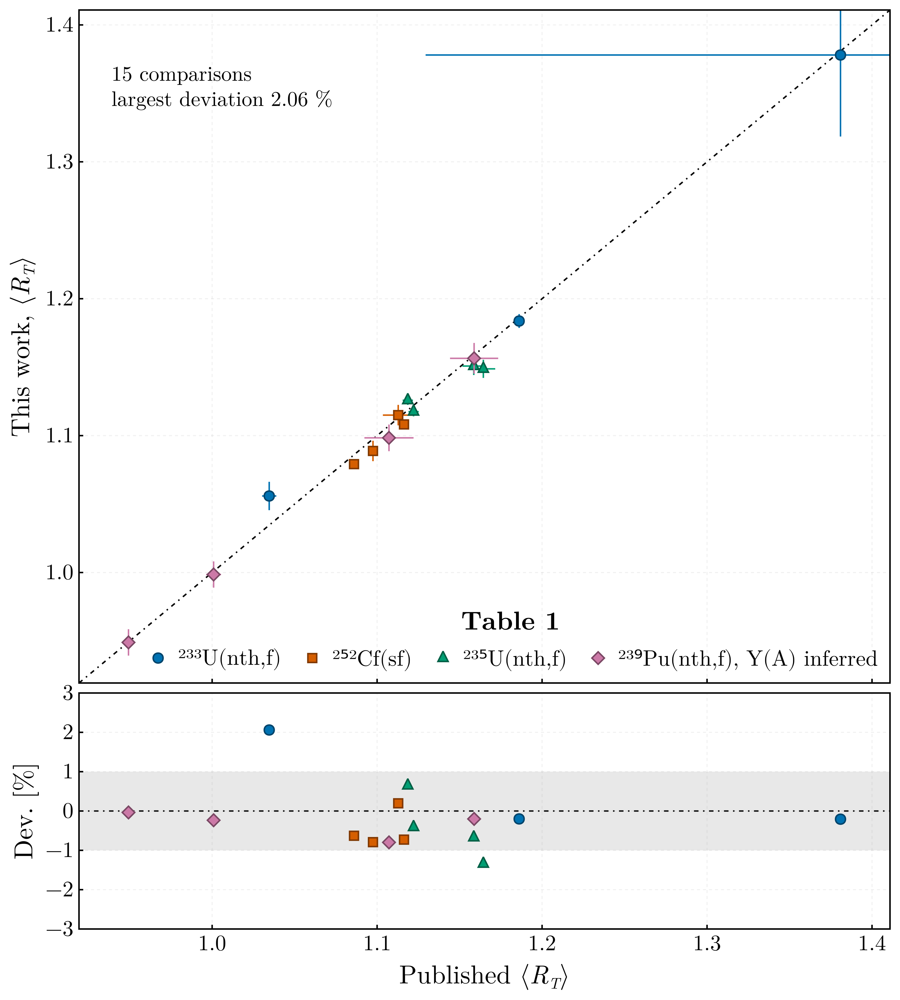

# Validation

What has been checked, and what has not. Stated explicitly because the method is published and a
reader's first question is whether this reproduces it.

Verified:

- The exact identity at the symmetric split. `r_ν = 1/2` returns `R_T = 1` to 10⁻¹² on the four
  shipped domains, weighted and unweighted, as an outcome of the construction rather than an
  imposition, and a run reports it if it does not.
- The round trip with the consumer's partition. For every heavy mass of the ²⁵²Cf and ²³⁵U domains
  and `R_T` of 0.8, 1 and 1.45, the extraction returns `R_T` from the `E*_H/TXE` the shared forward
  relation gives, to a relative 10⁻¹², weighted and unweighted; with one charge per mass all three
  averagings reduce to the closed form. The uncertainty propagates with the slope of the inversion,
  checked against a finite difference, and the fitted curve is continuous at every breakpoint and
  stays inside the physical range.
- The shell structure. The level density parameter is suppressed threefold at the doubly magic
  heavy fragment relative to a mid-shell fragment, which is what gives `R_a(A_H)` its structure.
- The shape of the result. The segmented `r_ν(A_H)` reproduces the published systematic
  behaviour — one half at the symmetric split, a minimum near the heavy magic fragment, one half
  again near the most probable fragmentation, and a near-linear rise above it.
- **The published total averages, to within 1.0 %, one measurement aside.** The `⟨R_T⟩` of
  Table 1 of [Tudora2024](@cite), per `ν(A)` dataset and per `Y(A)` distribution, comes back from
  independently retrieved archive data (ExforFissionData.jl v0.2.7) with the published settings —
  the ratio of means over the digitised Gaussian charge tables, or the mean values for ²³³U, on the
  shared fragmentation domain:

  | System | `Y(A)` | Datasets compared | Largest deviation, published settings | Largest deviation, shipped settings |
  |---|---|---|---|---|
  | ²³³U(nth,f) | Surin | 3 of 3 | 1.89 % (Apalin; others 0.41 %) | 2.07 % (Apalin; others 0.21 %) |
  | ²⁵²Cf(sf) | Göök | 4 of 5 | 0.54 % | 0.79 % |
  | ²³⁵U(nth,f) | Al-Adili, Straede | 2 of 3 | 1.00 % | 1.34 % |
  | ²³⁹Pu(nth,f) | Nishio 1995, inferred by agreement | 4 of 5 | 0.68 % | 0.80 % |

  

  The figure shows the shipped settings over the distributions the table names; the shipped
  configurations average over one primary experiment's `Y(A)` per system, which for ²³³U, ²³⁵U
  and ²³⁹Pu is not among them.

  The ²³⁹Pu rows are averaged over a distribution inferred by agreement. The published table
  averages over an experimental distribution its caption does not identify, and over a second that
  is calculated and cannot be retrieved; over Nishio 1995 the Nishio, Apalin and Zamyatnin `ν(A)`
  rows come back to within 0.12 % and Fraser to 0.68 %, which identifies that distribution, or one
  close to it, without confirming it. The fifth row, Tsuchiya 2000, comes back to 0.20 % but is
  not asserted: the retrieval records its scale as off that of `ν̄` by 3.9 %, which cancels in
  `r_ν`.

  Apalin's ²³³U masses are given as non-integer values, 52 of them, which the retrieval
  interpolates onto 69 integers; rounded instead, as an earlier retrieval did, they paired only
  part of the yield, and the row came back to 0.60 %. The shipped settings — Wahl's 1988 charge
  model, the charge-resolved inversion weighted by the `⟨TXE⟩` of the configured `⟨TKE⟩(A)`
  dataset, and `Y(A)` symmetrized — hold every other row to within 1.34 %. Wahl's model moves the
  ²³³U rows by +0.29 % to +0.37 % from the mean values the paper used there, and the rows of the
  other systems by less than 0.1 %; the excitation weight moves every row by −0.04 % to −0.15 %;
  the symmetrization moves those over Göök's and Straede's distributions, the two measured on both
  wings, by −0.1 % to −0.7 %.

  Table 2 reproduces too for Nishio's ²³³U measurement, the Gilbert-Cameron variant to 0.20 % and
  the one-charge-per-mass variant to 0.60 %; Apalin's rows move with the interpolation, to 1.25 %
  and 2.08 %. The remaining datasets could not be compared because the archive query did not return
  the `ν(A)` measurement the table names.
- The uncertainty of the total average. The independent-points uncertainty reproduces the
  published one, ±0.0020 against ±0.0021 for ²³³U Nishio over Surin, and the
  covariance-propagated uncertainty is ±0.0050, two and a half times larger, because the tabulated
  points of a fitted curve are not independent. Fraser's sparse ²³³U set carries ±0.25 in the
  published table; read without uncertainties, as it was retrieved before, it gave ±0.23 here. The
  retrieval now reads the uncertainties its archive entry quotes at 16 of its 33 masses, and with
  them the covariance-propagated uncertainty is ±0.059, the independent-points one ±0.019.
- The suite passes on the declared Julia floor and on the current release.
- The level density models, against their papers: the back-shifted Fermi gas coefficients, shell
  correction, pairing term and liquid-drop coefficients of [vonEgidy2005, vonEgidy2009](@cite), and
  the Gilbert-Cameron eqs. (20) and (21) with Table III of [GilbertCameron1965](@cite). Both are
  FissionFragmentsDomain.jl's, which ships the table and tests the transcription; this package's
  own implementations, checked against the same sources before they were retired, give the same
  total averages to 5 × 10⁻⁶ under the published settings.

Not verified:

- The yield distribution of the ²³⁹Pu rows of Table 1, Nishio 1995, which is inferred by
  agreement rather than named by the paper.
- The effect of neglecting the back-shift. The level density parameter is taken from a systematic
  that fits it jointly with a back-shift `E1`, while the extraction rests on the un-shifted
  `E* = a T²` the method is published under. `E1` differs between the two fragments, so it does not
  cancel in the ratio; at order ±1 MeV against fragment excitations of 10-20 MeV the effect is
  expected to be small, but it has not been quantified.
- The path for a fissioning nucleus of odd mass number is covered only by unit tests; no such case
  exists in the data.
